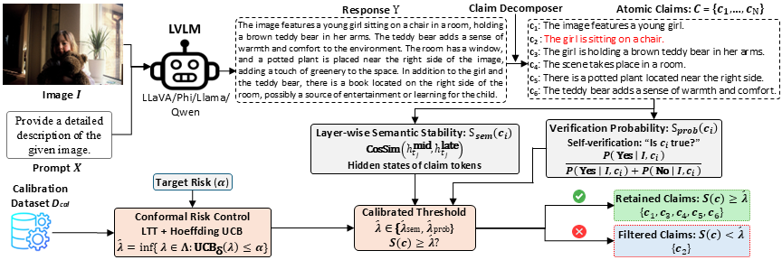
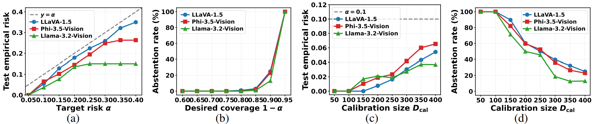
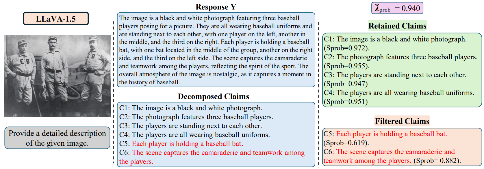

<div align="center">

# IntroConformal: Conformal Factuality Guarantees for Large Vision-Language Models via Introspective Signals

**[Md. Atabuzzaman](https://github.com/Atabuzzaman), Christian Alexander, Chris Thomas**

Department of Computer Science, Virginia Tech

**EMNLP 2026 (Main Conference)**

[](https://aclanthology.org/2026.emnlp-main.2585/)
[](https://aclanthology.org/2026.emnlp-main.2585.pdf)
[](https://aclanthology.org/2026.emnlp-main.2585/)
[](#code)
[](#datasets)

</div>

---

<!-- FIGURE: Pipeline overview (Figure 1 in the paper). Export to assets/pipeline.png -->
<p align="center">
  
</p>
<p align="center"><em>
<b>Overview of IntroConformal.</b> An LVLM response is decomposed into atomic claims, each claim is scored with a model-internal signal (S<sub>sem</sub> or S<sub>prob</sub>), and claims below a CRC-calibrated threshold are filtered out.
</em></p>

## 📖 Overview

Large Vision-Language Models (LVLMs) frequently generate claims that are not grounded in the input image, and users have no reliable way to tell which parts of a response to trust. Existing conformal factuality methods score claims with generation-time token probabilities, which are unreliable for confident hallucinations, or with external verifiers such as CLIP, which add extra models and dependencies.

**IntroConformal** is a **training-free Conformal Risk Control (CRC)** framework that provides **finite-sample, distribution-free factuality guarantees** for LVLMs using signals from **the model itself**, with no external verifier.


## 🔍 Method

<!-- OPTIONAL FIGURE: a compact diagram of the two scores. Export to assets/scores.png -->
<!--
<p align="center">
  
</p>
-->

1. **Claim decomposition.** Each LVLM response is split into atomic claims.
2. **Claim scoring.** Each claim receives a conformity score from S<sub>sem</sub> (hidden states) or S<sub>prob</sub> (output logits).
3. **Calibration.** On a held-out calibration set, we compute the response-level risk for each candidate threshold λ, bound it with a Hoeffding UCB, and select the least conservative λ whose bound meets the user-specified target α.
4. **Filtering.** At test time, claims with scores below the calibrated threshold are removed. A response whose claims are all removed is treated as an abstention.

Because the target α is set by the user, the guarantee forms a tunable trade-off between factuality and abstention.

## 📊 Results

<!-- FIGURE: CRC results on MSCOCO (Figure 2 in the paper). Export to assets/results_mscoco.png -->
<p align="center">
  
</p>
<p align="center"><em>
Empirical risk vs. target α, abstention vs. desired coverage, and test risk/abstention vs. calibration size on MSCOCO across LVLMs.
</em></p>

**Signal quality (LLaVA-1.5-7B, MSCOCO, claim-level AUROC)**

| Score | AUROC ↑ |
|:--|:--:|
| Layer-wise semantic stability (S<sub>sem</sub>) | 0.556 |
| Token probability (T<sub>prob</sub>) | 0.611 |
| CLIP (external verifier) | 0.631 |
| **Verification probability (S<sub>prob</sub>)** | **0.819** |

**Conformal filtering (LLaVA-1.5-7B, MSCOCO, α = 0.10)**

| Method | Abstention ↓ | F1 ↑ |
|:--|:--:|:--:|
| CONFLVLM (CLIP-based) | 57% | 0.504 |
| IntroConformal (S<sub>sem</sub>) | 64% | – |
| **IntroConformal (S<sub>prob</sub>)** | **25%** | **0.581** |

Please see the paper for full results on all five models and three tasks, as well as the label-noise robustness analysis.

### Qualitative examples

<!-- FIGURE: Qualitative examples (Figure 3 in the paper). Export to assets/qualitative.png -->
<p align="center">
  
</p>

## 🤖 Models

| Model | Hugging Face |
|:--|:--|
| LLaVA-1.5-7B | [`llava-hf/llava-1.5-7b-hf`](https://huggingface.co/llava-hf/llava-1.5-7b-hf) |
| Phi-3.5-Vision-Instruct | [`microsoft/Phi-3.5-vision-instruct`](https://huggingface.co/microsoft/Phi-3.5-vision-instruct) |
| Llama-3.2-11B-Vision | [`meta-llama/Llama-3.2-11B-Vision-Instruct`](https://huggingface.co/meta-llama/Llama-3.2-11B-Vision-Instruct) |
| Qwen2.5-VL-7B-Instruct | [`Qwen/Qwen2.5-VL-7B-Instruct`](https://huggingface.co/Qwen/Qwen2.5-VL-7B-Instruct) |
| Qwen3-VL-8B-Instruct | [`Qwen/Qwen3-VL-8B-Instruct`](https://huggingface.co/Qwen/Qwen3-VL-8B-Instruct) |

## 📁 Datasets

> 🚧 **Coming soon.** Calibration and test splits with claim-level factuality labels will be released here.

| Task | Source | # Images | Calibration / Test |
|:--|:--|:--:|:--:|
| Scene understanding | MSCOCO | 500 | 400 / 100 |
| Fine-grained captioning | CUB-200, Stanford Cars, Stanford Dogs | 516 | 400 / 116 |
| Document understanding | SROIE (invoices) | 500 | 400 / 100 |

## 💻 Code

> 🚧 **Coming soon.** We are cleaning up the code and will release it shortly.

Planned contents:

- [ ] Environment setup and requirements
- [ ] Response generation and atomic claim decomposition
- [ ] Introspective score extraction (S<sub>sem</sub> and S<sub>prob</sub>)
- [ ] Conformal Risk Control calibration and evaluation
- [ ] Scripts to reproduce the main tables and figures
- [ ] Calibration and test data release

<!--


## 📝 Citation

If you find this work useful, please cite:

```bibtex
@inproceedings{atabuzzaman2026introconformal,
    title = "{I}ntro{C}onformal: Conformal Factuality Guarantees for Large Vision-Language Models via Introspective Signals",
    author = "Atabuzzaman, Md.  and Alexander, Christian  and Thomas, Chris",
    booktitle = "Proceedings of the 2026 Conference on Empirical Methods in Natural Language Processing",
    month = oct,
    year = "2026",
    address = "Budapest, Hungary",
    publisher = "Association for Computational Linguistics",
    url = "https://aclanthology.org/2026.emnlp-main.2585/",
    pages = "58747--58764",
    ISBN = "979-8-89176-459-0"
}
```


## 📬 Contact

For questions, please open an issue or contact **Md. Atabuzzaman** at [atabuzzaman@vt.edu](mailto:atabuzzaman@vt.edu).
